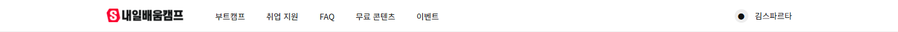
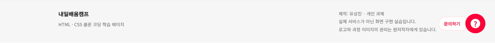

# 내일배움캠프 클론 코딩

유상진 | Chapter 2 HTML · CSS 개인 과제

## 1. 목적과 구현 범위
내일배움캠프의 메인 화면 일부를 HTML과 CSS로 구현한다. 화면을 **헤더 → 배너 → 과정 소개 → 푸터**로 나누고, 각 영역의 역할과 반응형 배치를 익힌다.

- 참고 사이트: https://nbcamp.spartaclub.kr/
- 기존 `project_yoosangjin/nbcamp_sparta.html` 작업을 기반으로 정리했다.
- 헤더: 로고, 메뉴, 사용자 표시. Flex로 정렬한다.
- 배너: 배경 이미지 위에 실제 HTML 텍스트를 배치한다.
- 본문: 제목, 과정 이미지, 교육 기간, 마감 안내를 표시한다.
- 푸터: 원본 작업에 없던 학습용 안내를 추가했다. 실제 사이트 푸터를 복제한 영역은 아니다.
- 모바일: 메뉴 줄바꿈, 제목 크기 조정, 카드 너비 조정, 배너 대비 보완.

**정적 화면 과제다.** 로그인, 문의, 메뉴의 실제 서비스 연결 및 데이터 저장은 구현하지 않았다. 교육 기간과 마감 문구는 기존 실습 화면의 예시다.

## 2. 실행
1. 저장소를 다운로드하거나 복제한다.
2. `index.html`을 Chrome 등 브라우저로 연다.
3. 창 너비를 줄여 반응형 화면을 확인한다.

별도 설치, 서버 실행, API 키가 필요 없다. 이미지와 폰트는 로컬 파일을 사용한다.

## 3. 파일 구조
```text
index.html                 HTML과 CSS
images/                    로고·배너·과정 이미지
font/                      Noto Sans KR Regular 및 OFL 라이선스
docs/screenshots/          실제 브라우저 캡처
docs/browser-test-results.json  화면 검증 결과
```

## 4. 핵심 개념
| 개념 | 적용과 역할 |
|---|---|
| 시맨틱 HTML | header·nav·section·main·article·footer로 문서 역할 구분 |
| Flexbox | 헤더 메뉴와 푸터 내용을 정렬하고 좁은 화면에서 줄바꿈 |
| 미디어 쿼리 | 900px·480px 기준으로 화면 배치와 글자 크기 조정 |
| 상대 너비 | 화면 폭에 맞춰 콘텐츠 폭을 줄여 가로 넘침 방지 |
| position | 배너 글자 위치와 고정 문의 표시 구현 |
| 접근성 기초 | 한국어 문서 지정, 이미지 대체 텍스트, 링크 포커스 표시 |

## 5. 실행 검증
Chrome에서 1440·1024·768·390·320px 화면 너비로 검사했다.
- 가로 넘침 없음.
- 이미지 로딩 성공.
- header·main·footer 존재 확인.
- 브라우저 실행 오류 없음.
- 전체·헤더·본문·푸터·모바일 실제 렌더링 캡처 저장.

테스트는 레이아웃과 자원 로딩을 대상으로 한다. 실제 사이트와 픽셀 단위 일치나 서비스 기능 동작을 의미하지 않는다.

## 6. 제출 화면
### 전체 화면

### 헤더

### 메인

### 푸터

### 모바일 390px


## 7. 기존 작업 보완 사항
한국어 문서 설정, 폰트·테두리 선언 오류 수정, 중복 종료 태그 제거, 반응형 CSS와 학습용 푸터 추가. 원본 파일은 보존했다.

## 자료 이용 안내
로고·배너·과정 이미지는 내일배움캠프 화면 구현 학습 목적으로 사용했다. 이미지 권리는 원저작자에게 있으며 본 저장소는 공식 서비스가 아니다. Noto Sans KR 폰트는 `font/OFL.txt`의 SIL Open Font License를 따른다.